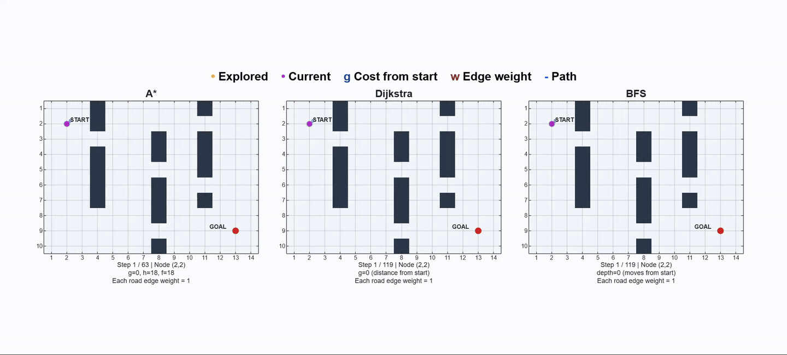

# Global Path Planning Algorithms

A MATLAB demonstration of A*, Dijkstra, and breadth-first search (BFS) on the same obstacle map. The animation highlights each node as it is explored, shows its current cost, and draws each final shortest path step by step.



[Watch the comparison video](path_planning_comparison.mp4) · [View measured results](comparison_results.csv)

## Run

Open MATLAB, set the current folder to this project, and run:

```matlab
path_planning_demo
```

The script generates `path_planning_comparison.mp4`, `comparison_final.png`, and `comparison_results.csv`. It uses MATLAB built-in graphics and VideoWriter. From PowerShell in this folder, you can also run `matlab -batch "path_planning_demo"`.

## Map and plot

The 10-by-14 grid represents a graph: every free cell is a node; adjacent horizontal or vertical free cells are connected by an edge with weight 1. Dark cells are blocked. All algorithms use the same start and goal, and no diagonal movement is allowed. Green marks the start, red marks the goal, orange marks explored nodes, purple marks the current node, and blue marks the final route. The final path's edges are labeled with a red `1`, so adding them gives the path cost in moves. Every traversable edge has weight 1; only final-route edge weights are labeled to keep the map readable.

The blue number beside each explored node shows its calculated cost from the start (for BFS, its depth in moves). These are path costs, not fixed node weights. The current node's coordinates and cost appear below each plot. A* displays `g` (distance from start), `h` (Manhattan distance to goal), and `f = g + h`; Dijkstra displays `g`; BFS displays the number of moves from the start. These are calculated scores, not fixed node weights.

## Algorithms

- **A\*** selects the open node with the smallest `f = g + h`. Manhattan distance is an admissible and consistent heuristic for four-direction unit-cost movement, so A* finds a shortest path on this grid.
- **Dijkstra** selects the open node with the lowest distance from the start. It finds a shortest path for nonnegative edge weights.
- **BFS** uses a first-in, first-out queue to explore nodes in order of their number of moves from the start. Because all edges have equal weight in this demo, BFS also finds a shortest path. BFS does not generally find the minimum-weight path when edge weights differ.

## Time and space complexity

Let `V` be the number of grid cells and `E` the number of traversable neighbor connections. Bounds below describe these implementations. The grid has at most four neighbors per cell, so `E = O(V)`. Edges are generated as needed, rather than stored in an adjacency list.

| Algorithm | Best-case time | Worst-case time | Best-case space | Worst-case space | Implementation |
| --- | --- | --- | --- | --- | --- |
| A* | O(V) | O(V^2 + E) | O(V) | O(V) | Array scan selects the lowest-score open node. |
| Dijkstra | O(V) | O(V^2 + E) | O(V) | O(V) | Array scan selects the lowest-distance open node. |
| BFS | O(V) | O(V + E) | O(V) | O(V) | An array-backed queue visits each reachable node once. |

The best case assumes the start is already the goal. Even then, each implementation initializes arrays sized to all V grid cells, so best-case time and auxiliary space are O(V), not O(1). These bounds are for this code; an implementation that allocates memory lazily can have different best-case costs.

Using an appropriate heap can improve the usual graph-search time bound for A* or Dijkstra. The measured runtime in the CSV is a single local run.

## Validation and limitations

The script checks that all three path lengths match and reports an error if any planner fails or disagrees. The included video, image, and CSV are produced by the script. Equal-length shortest paths can have different shapes depending on tie-breaking. This grid is an educational model; it does not simulate vehicle dynamics, road traffic, or actual driving.

