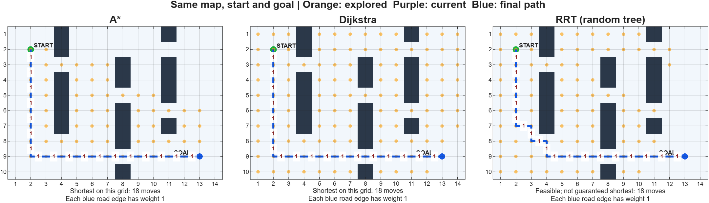

# MATLAB path-planning comparison

A MATLAB animation comparing A*, Dijkstra, and a discrete grid-based RRT on the same small obstacle map. A green node is the start, a red node is the goal, dark cells are obstacles, orange marks show examined or added nodes, purple marks the current node, and the blue line and marker show the final path. The video contains the visualization; algorithmic complexity is documented here.

## Run

In MATLAB, change the current folder to this project directory and run:

```matlab
path_planning_demo
```

The script writes `path_planning_comparison.mp4`, `comparison_final.png`, and `comparison_results.csv`. It uses MATLAB built-in graphics and VideoWriter; no external data, API, or toolbox is required. On Windows from PowerShell, use `matlab -batch "path_planning_demo"` from this folder.

## Map and cost

The map is a 10-by-14 grid. Each free cell is a node and each free horizontal or vertical neighbor is connected by an edge of cost 1. Obstacles cannot be traversed and diagonal movement is not allowed. All three planners use the same start, goal and movement rules. The displayed path length counts grid moves, not physical distance. This is an educational graph, not a model of a real vehicle's steering or dynamics.

## Algorithms

- **Dijkstra:** chooses the open node with the smallest distance from the start. With these nonnegative edge weights, it finds a shortest path.
- **A\*:** chooses the open node with the smallest `f = g + h`, where `g` is the distance already traveled on the candidate path and `h` is Manhattan distance to the goal. Manhattan distance is admissible and consistent for unit-cost four-direction movement, so A* finds a shortest path. It may explore fewer nodes, although ties and the map affect the actual count.
- **RRT:** this is an educational, discrete, graph-based variant. It samples a random free cell, finds the nearest existing tree node by Manhattan distance, and tries to add an adjacent unvisited free node. The seed is fixed at 42 for repeatability. It stops at its first route to the goal. Basic RRT does **not** guarantee the shortest path, so it is labeled as a feasible route in the video. If it cannot find a route within 20,000 sampling attempts, the script reports failure. This is not continuous-space RRT or RRT*.

## Time and space complexity

Let `V` be the number of grid cells, `E` the number of possible graph edges, and `T` the number of RRT sampling attempts. These bounds describe this implementation, not every implementation of the algorithms.

| Algorithm | Worst-case time | Space | Why |
|---|---|---|---|
| A* | O(V² + E) | O(V) on this implicit grid | An array scan selects the best open node; up to V nodes are expanded. Distance, predecessor and state arrays have V entries. |
| Dijkstra | O(V² + E) | O(V) on this implicit grid | Uses the same array-based selection and state arrays. |
| Discrete RRT | O(TV) | O(V) | Every attempt scans the current tree for the nearest node; the tree has at most V nodes. |

The grid has at most four neighbors per cell, so `E = O(V)`. Binary heaps can improve the usual graph-search bound for A* and Dijkstra, but this demo deliberately uses a simple array scan. RRT performance also depends on random samples and the stopping limit; it is not guaranteed to find a path in a fixed number of attempts.

## Results and limitations

The generated CSV records route length, explored or tree-added nodes, and search runtime for this run. Dijkstra and A* route lengths are checked against one another. Runtime is measured once on the local machine and is not a robust benchmark. RRT's recorded node count counts nodes added to its tree, whereas A* and Dijkstra counts are expanded nodes, so they are not identical operations. The final picture and video come from the actual run.

## Reading the step-by-step plot

The purple dot is the node currently selected (or newly added for RRT); its `(column, row)` coordinates and node cost appear below the corresponding map. For A*, `g` is the best discovered cost from the start, `h` is Manhattan distance to the goal, and `f = g + h` determines the next node selected. For Dijkstra, the displayed `g` is its tentative path cost and determines selection. For RRT, `g` is the number of edges from the start along its current tree; RRT selects its tree node using distance to a random sample, not by minimizing `g` or `f`. These values are calculated path costs, not fixed weights attached to nodes.

Each traversable edge has weight 1. As the final path is drawn, its edges are labeled `1`; summing them gives the displayed route cost in moves. The 1 labels are added for the selected route so they remain legible, rather than drawing labels on every edge of the map.

## Generated outputs

- [Watch the MATLAB comparison video](path_planning_comparison.mp4)
- [View the final comparison plot](comparison_final.png)
- [Download the measured results](comparison_results.csv)



On the included map, A* and Dijkstra each found an 18-move shortest path. The fixed-seed RRT run also found an 18-move path in this particular run; that result does not give RRT a shortest-path guarantee. The CSV records the measured node counts and single-run timings. Timings vary by machine and should not be treated as a statistically meaningful benchmark.
